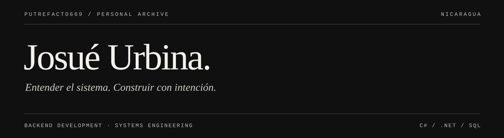

<div align="center">




<br />

<samp>ESTUDIANTE DE INGENIERÍA EN SISTEMAS · DESARROLLADOR BACKEND</samp>

<br /><br />

[Sobre mí](#01--detrás-del-código) &nbsp; / &nbsp; [Stack](#02--herramientas-del-oficio) &nbsp; / &nbsp; [Proyectos](#03--trabajo-seleccionado) &nbsp; / &nbsp; [Contacto](#05--conversemos)

<br />

<sub>Nicaragua · Ecosistema .NET · Arquitectura de software · Proyectos con propósito</sub>

</div>

<br />

## 01 / Detrás del código

Soy **Josué Urbina**, estudiante de **Ingeniería en Sistemas** y desarrollador enfocado en **C#, ASP.NET Core y SQL Server**. Me interesa entender cómo encajan las piezas de una aplicación: sus datos, sus reglas y las decisiones que permiten mantenerla en el tiempo.

Construyo aplicaciones web, sistemas administrativos y herramientas que resuelven problemas concretos. Actualmente trabajo en **RoomDesk** y en el desarrollo y mantenimiento de soluciones para la industria hotelera.

> Primero, entender el problema. Después, darle una estructura. Siempre, seguir mejorando.

```text
enfoque      → backend · bases de datos · arquitectura
ahora        → RoomDesk · soluciones para hotelería
aprendiendo  → Clean Architecture · Docker · Azure · CI/CD
fuera del IDE → música · videojuegos · diseño visual
```

<br />

## 02 / Herramientas del oficio

**Mi núcleo de trabajo**

<p>
  
  
  
  
</p>

| Área | Tecnologías y conceptos |
| :--- | :--- |
| **Backend** | C# · .NET 8 · ASP.NET Core MVC · APIs REST |
| **Datos** | SQL Server · T-SQL · Entity Framework Core · ADO.NET |
| **Otras bases de datos** | PostgreSQL · MySQL · SQLite |
| **Interfaz web** | Razor Views · JavaScript · HTML · CSS · Bootstrap |
| **Arquitectura** | MVC · capas · separación de responsabilidades |
| **Entorno** | Git · GitHub · Visual Studio · VS Code · Postman · Linux · Windows |

<details>
<summary><b>Otros lenguajes y tecnologías que exploro</b></summary>

<br />

Python, PHP y Ruby forman parte de mi recorrido de aprendizaje. Estoy profundizando en Docker, Azure, automatización con CI/CD y Clean Architecture para seguir ampliando mi forma de construir y desplegar aplicaciones.

</details>

<br />

## 03 / Trabajo seleccionado

### RoomDesk
<samp>01 — SISTEMA DE GESTIÓN HOTELERA</samp>

Una aplicación para centralizar la operación de un hotel, desde la administración de habitaciones hasta la experiencia de reserva.

**C# · ASP.NET Core MVC · .NET 8 · JavaScript**

- **Operación:** administración de habitaciones, huéspedes, reservaciones y facturación.
- **Visibilidad:** panel con indicadores de ocupación e ingresos y reportes PDF con QuestPDF.
- **Reservas:** motor público y confirmaciones mediante EmailJS.
- **Persistencia:** almacenamiento local mediante archivos JSON.

[**Explorar código ↗**](https://github.com/Putrefacto669/RoomDesk) &nbsp; · &nbsp; [Ver demo ↗](https://putrefacto669.github.io/RoomDesk-Demo/)

---

### Registro Vehicular
<samp>02 — ADMINISTRACIÓN Y CONSULTA DE REGISTROS</samp>

Sistema web para registrar, consultar y administrar información vehicular, con una interfaz administrativa basada en MVC y generación y exportación de reportes.

**C# · ASP.NET Core MVC · SQL Server**

---

### VitaWA
<samp>03 — EXPLORACIÓN PERSONAL</samp>

Un proyecto personal que forma parte de mi exploración de nuevas soluciones de software y del aprendizaje a través de la práctica.

[**Explorar código ↗**](https://github.com/Putrefacto669/VitaWA)

<br />

## 04 / En construcción

Mi recorrido empezó con fundamentos de programación e Ingeniería en Sistemas en **2024**. En **2025** avancé hacia aplicaciones web y bases de datos con ASP.NET Core MVC y SQL Server. En **2026**, mi enfoque está en RoomDesk, soluciones para hotelería y arquitectura backend.

**Lo que sigue**

- [ ] Aplicar Clean Architecture en un proyecto orientado a producción.
- [ ] Contenerizar una aplicación .NET completa con Docker.
- [ ] Desplegar en Azure y automatizar entregas con CI/CD.
- [ ] Diseñar y documentar APIs REST escalables.
- [ ] Profundizar en Domain-Driven Design y fundamentos de Kubernetes.

<details>
<summary><b>Actividad en GitHub</b></summary>

<br />

<div align="center">


<br />

[Ver contribuciones y repositorios ↗](https://github.com/Putrefacto669?tab=repositories)

</div>

</details>

<br />

## 05 / Conversemos

Me interesan los proyectos que combinan **ingeniería y creatividad**: herramientas personalizadas, aplicaciones independientes y sistemas que hacen más sencillo el trabajo de alguien.

Si compartes ese interés, puedes conocer mi trabajo y conectar conmigo en GitHub.

[**@Putrefacto669 ↗**](https://github.com/Putrefacto669) &nbsp; / &nbsp; [Repositorios ↗](https://github.com/Putrefacto669?tab=repositories) &nbsp; / &nbsp; [RoomDesk ↗](https://github.com/Putrefacto669/RoomDesk)

<br />

---

<div align="center">

<br />


<br /><br />

<samp>UN COMMIT MÁS Y DESCANSO.</samp>

<br /><br />

<sub>Josué Urbina · Construir. Entender. Mejorar.</sub>

</div>
