<div align="center">

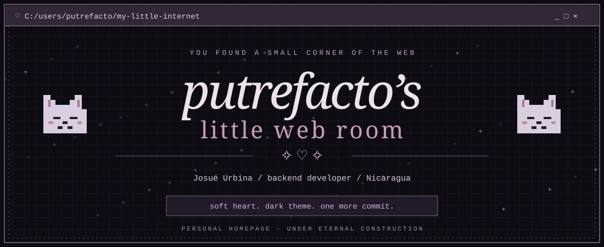

<br />

<samp>♡ bienvenido a mi rincón de internet. puedes quedarte un rato ♡</samp>

<br /><br />

[about me](#about-me) ⊹ [toolbox](#toolbox) ⊹ [projects](#projects) ⊹ [loading...](#loading) ⊹ [links](#links)

<br />

 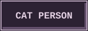  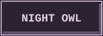 

<br /><br />

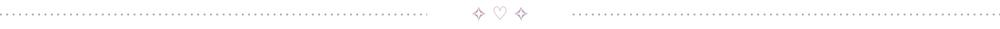

</div>

<a id="about-me"></a>
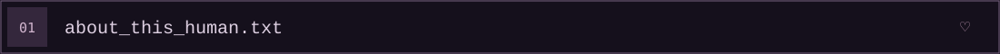

<table>
<tr>
<td width="67%" valign="top">

### Josué Urbina <sup>♡</sup>

<samp>@Putrefacto669 / Nicaragua / Ingeniería en Sistemas</samp>

Hola. Construyo cosas con **C#, ASP.NET Core y SQL Server** y trato de entender qué pasa detrás de cada pantalla.

Me interesan el backend, las bases de datos y la arquitectura de software. Actualmente trabajo en **RoomDesk** y en soluciones para la industria hotelera.

Este espacio es mitad portafolio, mitad habitación digital: código, música, videojuegos y un poco de caos organizado.

> Soft heart. Dark theme. One more commit.

</td>
<td width="33%" align="center" valign="middle">
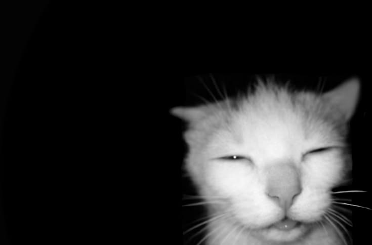
<br /><br />
<samp>head of quality assurance</samp>
<br />
<sub>revisa el código. se duerme.</sub>
</td>
</tr>
</table>

```text
┌─ user.config ─────────────────────────────────────┐
│ role       backend developer                     │
│ studying   ingeniería en sistemas                │
│ building   RoomDesk / software para hotelería    │
│ interests  arquitectura · SaaS · automatización   │
│ philosophy construir. entender. mejorar.         │
└──────────────────────────────────────────────────┘
```

<a id="toolbox"></a>
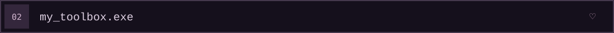

<br /><br />

| Directorio | Lo que hay dentro |
| :--- | :--- |
| `♡ /backend` | **C# · .NET 8 · ASP.NET Core MVC · REST APIs** |
| `♡ /database` | SQL Server · T-SQL · Entity Framework Core · ADO.NET |
| `♡ /also-data` | PostgreSQL · MySQL · SQLite |
| `♡ /frontend` | Razor Views · JavaScript · HTML · CSS · Bootstrap |
| `♡ /architecture` | MVC · arquitectura en capas · separación de responsabilidades |
| `♡ /tools` | Git · GitHub · Visual Studio · VS Code · Postman · Linux · Windows |
| `♡ /learning` | Docker · Azure · CI/CD · Clean Architecture |

<details>
<summary><samp>+ abrir el cajón de otros lenguajes</samp></summary>

Python, PHP y Ruby también forman parte de mi recorrido. Me gusta aprender construyendo proyectos reales, probando ideas y entendiendo por qué algo funciona.

</details>

<br />

<a id="projects"></a>
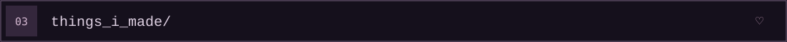

### ♡ RoomDesk
<samp>featured project / hotel management system</samp>

Un sistema para ordenar el pequeño caos de un hotel: habitaciones, huéspedes, reservaciones y facturación, en una sola aplicación.

**C# · ASP.NET Core MVC · .NET 8 · JavaScript**

- Panel administrativo con indicadores de ocupación e ingresos.
- Gestión de habitaciones, huéspedes, reservas y facturación.
- Motor público de reservas y confirmaciones con EmailJS.
- Reportes PDF con QuestPDF y persistencia local en JSON.

[**[ abrir repositorio ↗ ]**](https://github.com/Putrefacto669/RoomDesk) &nbsp; [**[ visitar demo ↗ ]**](https://putrefacto669.github.io/RoomDesk-Demo/)


### ♡ Registro Vehicular
<samp>web application / records & databases</samp>

Registro, consulta y administración de información vehicular, con interfaz administrativa MVC y generación y exportación de reportes.

**C# · ASP.NET Core MVC · SQL Server**


### ♡ VitaWA
<samp>personal project / experiments folder</samp>

Un espacio para explorar nuevas soluciones de software y seguir aprendiendo a través de la práctica.

[**[ abrir repositorio ↗ ]**](https://github.com/Putrefacto669/VitaWA)

<br />

<a id="loading"></a>
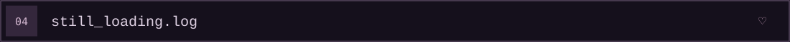

```text
2024  save_01  fundamentos de programación e Ingeniería en Sistemas
2025  save_02  aplicaciones web · ASP.NET Core MVC · SQL Server
2026  save_03  RoomDesk · hotelería · arquitectura backend
next  save_??  cloud · automatización · sistemas escalables
```

<details>
<summary><samp>+ side quests pendientes</samp></summary>

- [ ] Aplicar Clean Architecture en un proyecto orientado a producción.
- [ ] Contenerizar una aplicación .NET con Docker.
- [ ] Desplegar en Azure.
- [ ] Automatizar entregas con CI/CD.
- [ ] Diseñar y documentar APIs REST escalables.
- [ ] Profundizar en Domain-Driven Design y fundamentos de Kubernetes.

</details>

<details>
<summary><samp>+ abrir el registro de actividad</samp></summary>

Mi actividad, contribuciones y repositorios están disponibles en [mi perfil de GitHub](https://github.com/Putrefacto669).

</details>

<br />

<a id="links"></a>
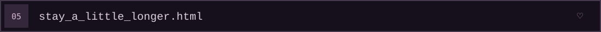

Me gustan los proyectos que mezclan ingeniería y creatividad. Si estás construyendo algo con personalidad, quizá tengamos cosas de qué hablar.

<div align="center">

[**[ github ↗ ]**](https://github.com/Putrefacto669) &nbsp; ⊹ &nbsp; [**[ mis repositorios ↗ ]**](https://github.com/Putrefacto669?tab=repositories) &nbsp; ⊹ &nbsp; [**[ RoomDesk ↗ ]**](https://github.com/Putrefacto669/RoomDesk)

<br />


<br /><br />

<samp>✧ internet se siente mejor cuando tiene rincones propios ✧</samp>

<br /><br />

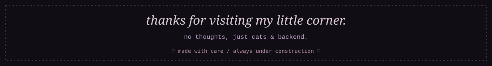

</div>
